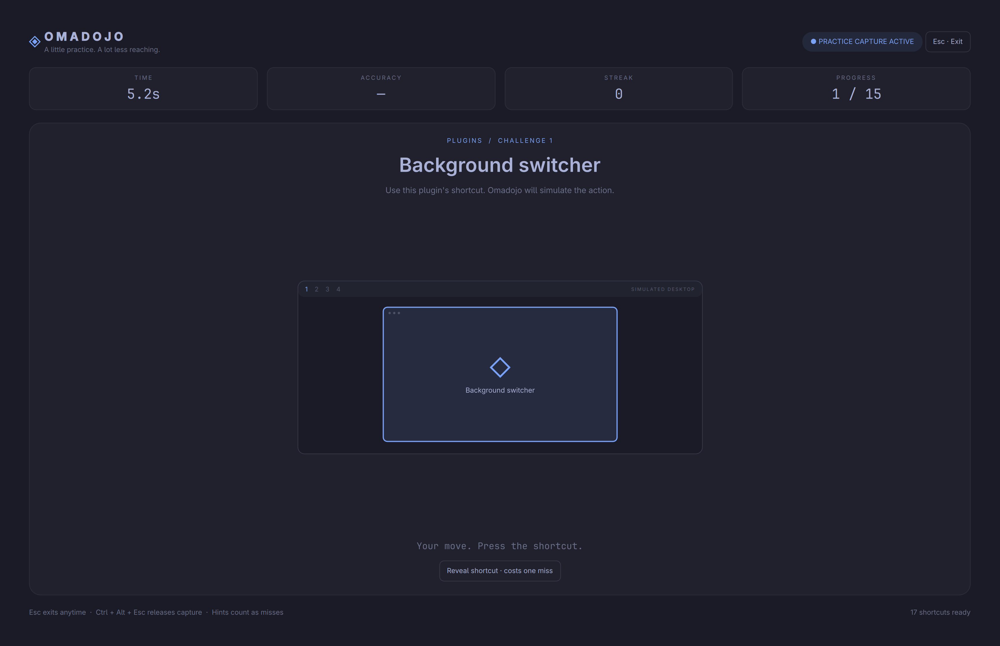

# Omadojo ◈

**Build Omarchy muscle memory.** A typing-test-style shortcut trainer for the Omarchy desktop and its plugins.



See a task, press the shortcut, and watch a simulated Omarchy desktop respond. Learn new shortcuts with guided keys and a goal preview, drill the ones you miss until they stick, then race for speed — without closing, moving, or launching your real applications.

## Install

Requires Omarchy's Quickshell plugin system, **Hyprland with Lua configuration** (tested with Omarchy 4.5.0rc2), and Python 3. No extra Python or Node packages are needed to run the plugin.

```sh
omarchy plugin add https://github.com/tkreek/omadojo.git --enable
```

Open **Omadojo** from the app launcher (search "Omadojo" or "shortcuts"), or run:

```sh
omarchy-shell shell toggle io.github.tkreek.omadojo
```

If you want a dedicated shortcut, add an unused combination to `~/.config/hypr/bindings.lua`:

```lua
-- Check that this combination is free in your configuration first.
o.bind("SUPER + CTRL + ALT + D", "Omadojo", { panel = "io.github.tkreek.omadojo" })
```

Then run `hyprctl reload` and `hyprctl configerrors`. Installing Omadojo itself does not edit your Hyprland config or add a global shortcut. A small service keeps a launcher entry at `~/.local/share/applications/omadojo.desktop` and deletes it again when the plugin is disabled or removed. It only rewrites or deletes a file carrying its `X-Omadojo-Managed` marker, so an edited copy is left alone, and it writes atomically so a symlink at that path is replaced rather than followed.

## Practice

1. Choose **Learn** or **Race** (**Tab** switches).
2. Pick a deck from the deck menu (**D**, or **1–9**, **0**): **All shortcuts**, **Applications**, **Windows**, **Navigation**, **Resize**, **Workspaces**, **Groups**, **Desktop**, **More**, **Plugins**, and **Mistakes** once you have some.
3. Choose 10, 20 or 30 prompts and press **Enter**.
4. Perform the task shown with its keyboard shortcut. The action happens on the simulated desktop.

**Escape** exits at any time. **Ctrl + Alt + Escape** is an independent compositor-level escape hatch while practice is active. The mouse Exit button also works.

### Learn mode

- New and weak shortcuts show their keys; once you answer a shortcut cleanly twice it must come from memory (**H** reveals it, counted as a miss).
- A small **Goal** window plays the action three times, then offers **Replay**.
- A wrong shortcut plays what that shortcut actually does on the desktop, flashes red, and names it. The goal then replays.
- Missed shortcuts return a few prompts later with their keys hidden.
- Rounds favour weak and missed shortcuts; large permutation families (workspaces 1–10, resize sizes) share their weight so they do not crowd out the rest.
- Each shortcut climbs a five-step mastery ladder. Progress, including what you pressed instead, is saved to `~/.local/state/omadojo/progress.json`. The round review lists every miss, what you pressed, and the right keys; **M** practises your mistakes.

### Race mode

Recall only: no guided keys or preview, a fast pace, and time, accuracy and streak in the top bar.

Keys pressed without Super, Ctrl or Alt are ignored rather than graded. Held-key repeats do not count. Shortcuts with several bindings (for example Close window on Super + W and Super + Q) accept any of them.

### Your actual shortcuts

Omadojo reads `hyprctl binds -j` and `hyprctl binds` when you open it. Lessons match action descriptions, so customised chords are used and unbound actions are left out. Bindings declared by keycode (`code:11`, as Omarchy does for workspaces and resizing) are recovered from the text output, and number keys are matched by keycode so they work on any layout.

Hand-written lessons cover applications, every window action, focus and swap in four directions, all twelve resize variants, workspaces 1–10 (switch, move, move silently), scratchpad and Quake console, groups, menus, bar panels, notifications, clipboard and capture. Every other described binding becomes a lesson in **More** (or **Plugins** for plugin toggles), so nothing you have bound is left out. Mouse binds, release-only binds, media keys, lone modifiers and bindings in other submaps are excluded.

## Keyboard takeover and recovery

During a round, Omadojo opens a fullscreen layer with exclusive keyboard focus and enters a temporary `omadojo-practice` Hyprland submap. Normal desktop shortcuts are suspended, and key events are graded inside the trainer. Lesson actions are never executed on the real desktop.

A Python watchdog owns capture and receives heartbeats from the UI. Normal exit, EOF, missed heartbeats (about five seconds), a ten-minute session limit, or termination signals restore the default submap and unbind the emergency shortcut. The watchdog runs in a separate process session so it can recover even if the shell kills its immediate child. If the compositor config reloads, practice ends.

Capture refuses to start from an existing non-default submap. Omadojo also refuses practice when any `submap_universal` binding exists, because those shortcuts would bypass the temporary submap. System-reserved keys and compositor input policies remain outside the plugin's control.

Manual recovery from another terminal or TTY:

```sh
hyprctl dispatch 'hl.dsp.submap("reset")'
# Or restore and remove the temporary emergency binding:
python3 ~/.config/omarchy/plugins/io.github.tkreek.omadojo/capture.py --restore
```

While the overlay is open, a second scoped watchdog temporarily disables
Hyprland's hide-cursor-on-keypress setting. Your previous cursor preference is
restored on close or process failure; desktop config files are never edited.
The pointer uses an explicit arrow shape over the practice surface.

Only the active practice session captures keys. Closing the overlay returns keyboard focus to your desktop. The plugin has no network access of its own and does not log typed input; the only thing it stores is per-shortcut mastery in `~/.local/state/omadojo/progress.json` (delete it to start fresh). That file is validated and rebuilt into a fixed shape when loaded, so a corrupted or hand-edited copy cannot inject unexpected data.

## Update / remove

```sh
omarchy plugin update io.github.tkreek.omadojo
omarchy restart shell

# Remove (close practice first):
omarchy plugin remove io.github.tkreek.omadojo
```

## Development

Zero dependency test suite:

```sh
npm test
omarchy plugin validate "$PWD"
```

An optional GitHub Actions workflow is in `contrib/github-actions-test.yml`; move it
to `.github/workflows/test.yml` using credentials with the `workflow` permission
to enable CI.

The tests cover binding discovery (including keycode recovery and multi-chord shortcuts), chord normalisation, scoring, hints, the mastery ladder, weighted and requeued rounds, that every lesson animates a visible change and every permutation looks distinct, watchdog timeouts, and process-death recovery using a fake `hyprctl`. They do not capture your real keyboard.

For a local checkout, link it into your plugin directory, rescan, then enable it once discovery finishes:

```sh
ln -s "$PWD" ~/.config/omarchy/plugins/io.github.tkreek.omadojo
omarchy-shell shell rescanPlugins
omarchy plugin enable io.github.tkreek.omadojo
```

After QML changes, restart the shell if a rescan keeps an older component instance. Do not restart during active practice unless you are deliberately testing crash recovery.

### Structure

- `Dojo.qml`: overlay, Learn/Race modes, input grading, round lifecycle, progress storage and live shortcut discovery.
- `DesktopScene.qml`: the practice desktop, wrong-shortcut playback, and the goal preview.
- `SimDesktop.qml`, `SimWindow.qml`: renders a scene as an Omarchy desktop (default bar, Hyprland tiling, groups, menus, panels, toasts, lock screen) with recognisable terminal, browser, files, Neovim, Obsidian, calculator and music windows.
- `Scenes.js`: pure before/after description of every lesson's desktop.
- `Engine.js`: chord matching, binding discovery, scoring, mastery and round building.
- `Lessons.js`: lesson catalogue, generated in permutation families.
- `KeyCaps.qml`, `DojoButton.qml`: small UI components.
- `Service.qml`: keeps the launcher entry in sync at shell startup.
- `capture.py`: temporary submap owner and independent input recovery watchdog.
- `i18n/en.json`: UI strings, using Omarchy's translation fallback.

Uses `Commons.Color` to avoid Qt 6.12's `Color` naming collision. Theme colors and reduced-motion settings follow Omarchy. No changes are made to packaged Omarchy files.

MIT licensed. Contributions for more visual lessons, plugin-specific decks, and translations are welcome.
